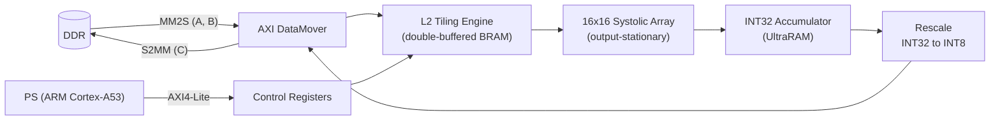

# INT8 GEMM Accelerator for Qwen2

An efficient hardware-accelerated solution designed to speed up the inference of Large Language Models (LLMs), specifically the **Qwen2** series, on the AMD Kria KV260 Vision AI Starter Kit.

## Overview

General Matrix Multiplication (GEMM) dominates the computational workload of Transformer-based LLMs. This project implements a high-performance **INT8 GEMM Hardware Accelerator** using a $16 \times 16$ **Systolic Array** in the Programmable Logic (PL) of the Xilinx Zynq UltraScale+ MPSoC.

Data is moved between DDR and the accelerator by an **AXI DataMover**, driven by a hardware **two-level tiling** engine. This lets the accelerator process large LLM matrices (e.g. $5120 \times 1280 \times 5120$) with no CPU involvement during a run.

---

## Key Features

* **Systolic Array Core:** A $16 \times 16$ output-stationary PE grid with DSP-based INT8 MACs and INT32 accumulation (peak 102.4 GOPS at 200 MHz).
* **Two-Level Tiling:** $256 \times 256 \times 256$ L2 blocks stream from DDR into on-chip buffers; $16 \times 16$ tiles are computed in the array. Partial sums over K are accumulated on-chip.
* **AXI DataMover I/O:** 128-bit MM2S/S2MM channels with commands generated in hardware; `done` is asserted only after all output writes are confirmed.
* **Overlapped Fetch/Compute:** Double-buffered L2 buffers let data fetch and computation run in parallel.
* **Quantization & Rescale:** Built-in hardware rescale pipeline (Round/Shift/Saturate) using the AbsMax symmetric quantization method to map FP32 weights/activations down to INT8.
* **Simple Control:** AXI4-Lite register block (config, start, busy/done, IRQ) driven by a C program on Linux.

---

## Performance & Accuracy Evaluation

* **Hardware Acceleration:** Significantly **faster** than the pure CPU ARM Cortex-A53 baseline.

| Test | Throughput | Speed-up vs. ARM |
|---|---|---|
| $512 \times 512 \times 512$ | ~16 GOPS | ~147x |
| $5120 \times 1280 \times 5120$ | ~17 GOPS | ~174x |

* **Bit-True Precision:** Hardware outputs deliver a **100% Bit-True match** against the CPU/PyTorch golden reference.
* **Quantization Quality:** Evaluation metrics (such as Cosine Similarity and SQNR) **fully pass** industry-standard LLM profiles.

---

## Project Structure & Source Code

* **Hardware (RTL):** Synthesizable Verilog, including the PE/MAC pipeline, skew network, dataflow controller, L2 tiling engine, AXI4-Lite registers and rescale pipeline.
* **Block Design:** `gemm_system.bd` (Zynq PS, SmartConnect, AXI DataMover, control registers, accelerator).
* **Software:** C test programs using `/dev/mem`:
  * `512x512.c` – functional test with bit-exact check against a CPU reference.
  * `5120x1280x5120.c` – large benchmark against the CPU baseline.
* **Target Model:** Based on the **Qwen2-Audio** implementation from [Audio_Speech_Conversation](https://github.com/tranquangchung/Audio_Speech_Conversation).
* **Quantization & Verification:** [Kaggle Notebook](https://www.kaggle.com/code/duynguynngphng/qwen2-analysis)

---

*Project by:*
* **Nguyen Dang Phuong Duy** - [DuyNDP](https://github.com/DuyNDP)
* **Vu Dai Duong** - [VuDaiDuong_325](https://github.com/VuDaiDuong-325)
