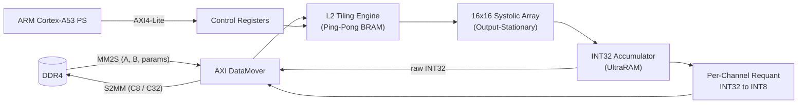
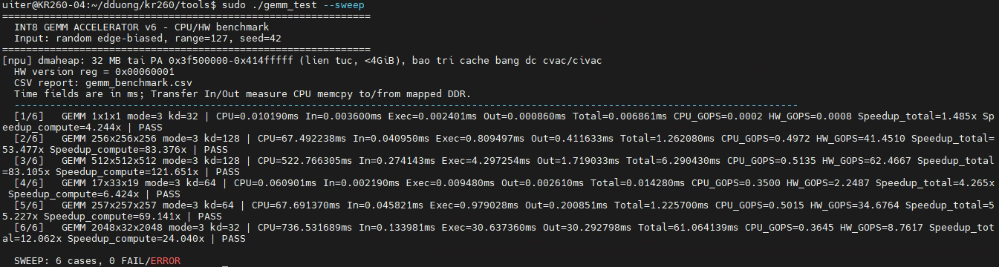

# INT8 GEMM Hardware Accelerator (Kria KV260 / KR260)

A Programmable Logic (PL) hardware accelerator for **INT8 matrix multiplication (`GEMM`)** on the AMD/Xilinx Zynq UltraScale+ MPSoC (Kria KV260 / KR260). It uses a $16 \times 16$ **Output-Stationary Systolic Array** running at **200 MHz** (peak **102.4 GOPS**) to accelerate dense linear layers in LLM and Audio-LLM inference.

---

## Overview

Given two row-major INT8 matrices $A_{M \times K}$ and $B_{K \times N}$ in DDR4 memory, an **AXI DataMover** streams matrix blocks into on-chip BRAM buffers. A hardware tiling engine computes $C = \mathrm{requant}(A \cdot B)$ in INT32 precision, applies per-channel requantization, and writes back the **INT8** output and/or raw **INT32** accumulators directly to DDR without CPU intervention.



### Key Features

* **$16 \times 16$ Systolic Array:** 256 DSP48E2-based Output-Stationary PEs performing 256 INT8 MACs/cycle with INT32 accumulation (peak **102.4 GOPS** at 200 MHz).
* **Arbitrary Matrix Dimensions:** Supports $M, K, N \in [1, 1\,048\,575]$ with automatic hardware zero-padding and boundary masking (only DDR row strides require 16-byte alignment).
* **Two-Level Tiling & Ping-Pong Buffering:** Streams $256 \times 256 \times 256$ L2 blocks from DDR into double-buffered BRAMs while computing $16 \times 16 \times k_{\text{dim}}$ tiles in the systolic array.
* **Per-Channel Requantization & Raw INT32 Output:** Hardware `bias / mult / shift / zp` scaling per output column (`mode=1`), raw INT32 accumulator write-back (`mode=2`), or both (`mode=3`).
* **Zero-Copy CMA DMA-BUF Driver:** Allocates contiguous cacheable DDR buffers via `/dev/dma_heap/reserved` with user-space ARMv8 cache maintenance (`dc cvac` / `dc civac`).

---

## Design Verification (SystemVerilog Testplan & Simulation)

Prior to on-board FPGA deployment, the RTL hierarchy is verified bottom-up in **Vivado Simulator (`xsim`)** using 4 self-checking **SystemVerilog** testbenches paired with structured CSV verification plans (**62 test cases** covering arithmetic corners, protocol assertions, back-pressure, and canary memory guards):

| Testbench (`hardware/sim/testbench/`) | Verification Plan (`hardware/sim/testplan/`) | Target DUT (`hardware/rtl_ip/`) | Test Cases | Key Verification Scope & Simulation Result (`xsim`) |
| :--- | :--- | :--- | :-: | :--- |
| [`tb_requant_pc.sv`](hardware/sim/testbench/tb_requant_pc.sv) | [`tb_requant_pc_vp.csv`](hardware/sim/testplan/tb_requant_pc_vp.csv) | `int32_int8_requant_pc` (`int32_int8_rescale.v`) | **16** (`RQ_001..016`) | 7-cycle latency, 33b/65b signed overflow, `shift=0/1/62`, 0.5-LSB round-half-up, saturation clamp $[-128, 127]$. **PASS (`0` errors / 1.61M lane ops)** |
| [`tb_axil_regs.sv`](hardware/sim/testbench/tb_axil_regs.sv) | [`tb_axil_regs_vp.csv`](hardware/sim/testplan/tb_axil_regs_vp.csv) | `gemm_l2_axi_lite_regs` (`gemm_l2_axi_lite_regs.v`) | **14** (`AXL_001..014`) | Reset defaults, RO/bit-masking, `WSTRB[0]` gating, 1-cycle `start_o`, Clear-on-Read `done_sticky`/`irq_o`, AW/W/RREADY stalls. **PASS (`0` errors / 10.2K txns)** |
| [`tb_gemm_compute_core.sv`](hardware/sim/testbench/tb_gemm_compute_core.sv) | [`tb_gemm_compute_core_vp.csv`](hardware/sim/testplan/tb_gemm_compute_core_vp.csv) | `gemm_compute_core` (+ 7 submodules) | **16** (`CC_001..016`) | Diagonal skew wavefront, $K=4096$ signed extremes, `MIN_PERIOD=48` guard, zero-bubble ping-pong chaining, FIFO C high-water stall. **PASS (`0` errors / 134 blocks)** |
| [`tb_gemm_top_l2.sv`](hardware/sim/testbench/tb_gemm_top_l2.sv) | [`tb_gemm_top_l2_vp.csv`](hardware/sim/testplan/tb_gemm_top_l2_vp.csv) | `gemm_top_l2` (`l2_tiling_agu.v`) + `gemm_l2_axi_lite_regs` | **16** (`TOP_001..016`) | All 3 output modes, 14 invalid-config error checks (`err_o`), odd $M/K/N$ padding/tkeep with `0xAA/0xCC` canary guards, 3D tiling, 5-channel DMA back-pressure. **PASS (`0` errors / 69 jobs)** |

---

## On-Board Verification & Benchmark Results (`Kria KR260 @ 200 MHz`)

Measured directly on the **Xilinx Kria KR260** (`sudo ./gemm_test --sweep`, `mode=3` verifying both **INT8** and **raw INT32** outputs against the CPU reference, edge-biased random inputs in $[-128, 127]$, `seed=42`). **PASS** indicates a 100% bit-exact match on all output elements and untouched DDR padding bytes.

| Case | Matrix Shape ($M \times K \times N$) | $k_{\text{dim}}$ | CPU Ref (ms) | Transfer In (ms) | HW Exec (ms) | Transfer Out (ms) | Total HW (ms) | HW Throughput (GOPS) | Speedup (Total / Compute) | Status |
| :-: | :--- | :-: | ---: | ---: | ---: | ---: | ---: | ---: | ---: | :-: |
| 1 | `1 x 1 x 1` | 32 | 0.010 | 0.004 | 0.002 | 0.001 | 0.007 | 0.0008 | **1.49x / 4.24x** | **PASS** |
| 2 | `256 x 256 x 256` | 128 | 67.492 | 0.041 | 0.809 | 0.412 | 1.262 | **41.45** | **53.48x / 83.38x** | **PASS** |
| 3 | `512 x 512 x 512` | 128 | 522.766 | 0.274 | 4.297 | 1.719 | 6.290 | **62.47** | **83.11x / 121.65x** | **PASS** |
| 4 | `17 x 33 x 19` | 64 | 0.061 | 0.002 | 0.009 | 0.003 | 0.014 | 2.25 | **4.27x / 6.42x** | **PASS** |
| 5 | `257 x 257 x 257` | 64 | 67.691 | 0.046 | 0.979 | 0.201 | 1.226 | **34.68** | **55.23x / 69.14x** | **PASS** |
| 6 | `2048 x 32 x 2048` | 32 | 736.532 | 0.134 | 30.637 | 30.293 | 61.064 | 8.76 | **12.06x / 24.04x** | **PASS** |

<p align="center">
  <br>
  <em>On-board execution of <code>sudo ./gemm_test --sweep</code> on Kria KR260 (6/6 bit-exact PASS, up to 62.47 GOPS and 121.65x compute speedup in simultaneous INT8 + INT32 mode).</em>
</p>

---

## Project Structure

```text
int8-matmul-accelerator/
├── LICENSE
├── README.md
├── docs/
│   └── images/                # On-board KR260 benchmark screenshots
├── hardware/
│   ├── rtl_ip/                # Verilog RTL core (Systolic Array, L2 Tiling AGU, Requant, AXI-Lite)
│   ├── sim/
│   │   ├── testplan/          # CSV verification plans (*_vp.csv, 62 test cases across 4 modules)
│   │   └── testbench/         # Self-checking SystemVerilog testbenches for Vivado xsim
│   └── system/
│       └── Block_design/      # Vivado Block Design (.bd, .tcl) and top-level system wrappers
└── software/
    ├── drivers/               # User-space CMA DMA-BUF (/dev/dma_heap) and /dev/mem NPU drivers
    └── benchmarks/            # On-board C verification suites and DDR bandwidth probes
```

---

## Links

* **RTL Simulation Testbench (Kaggle):** [design-test](https://www.kaggle.com/code/dduong325/design-test)
* **End-to-End Application (Qwen2-Audio Dialogue Acceleration on Kria KR260):** [`qwen2-audio-fpga-accelerator`](https://github.com/VuDaiDuong-325/qwen2-audio-fpga-accelerator)

---

*Project by:*
* **Nguyen Dang Phuong Duy** - [DuyNDP](https://github.com/DuyNDP)
* **Vu Dai Duong** - [VuDaiDuong_325](https://github.com/VuDaiDuong-325)
