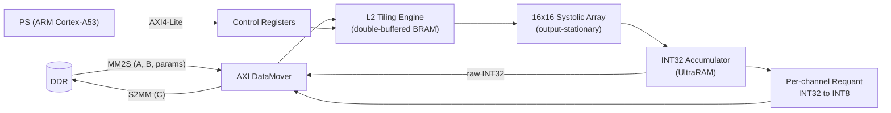
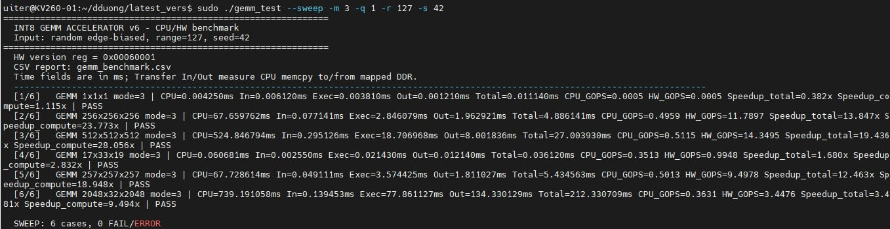
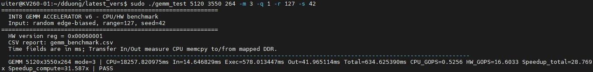
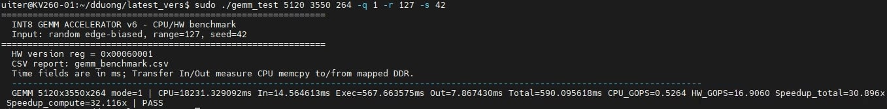
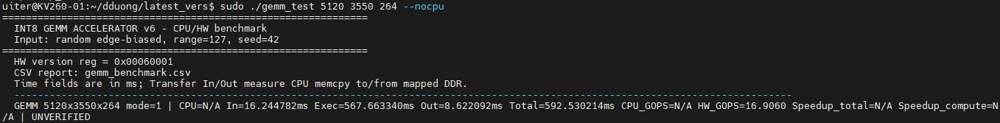

# INT8 GEMM Accelerator for Qwen2

A hardware accelerator that speeds up **INT8 matrix multiplication** (the dominant workload in LLM inference, here the **Qwen2** series) on the AMD Kria KV260. It uses a $16 \times 16$ **systolic array** in the Programmable Logic of the Zynq UltraScale+ MPSoC.

## Overview

Two INT8 matrices $A_{M \times K}$ and $B_{K \times N}$ are read from DDR by an **AXI DataMover**. A hardware tiling engine computes $C = \mathrm{requant}(A \cdot B)$ and writes back an **INT8** result and/or the raw **INT32** accumulators (for error checking). Once started, no CPU involvement is needed.



## Key Features

* **Systolic array:** $16 \times 16$ output-stationary PEs, DSP48E2-based INT8 MACs with INT32 accumulation (peak 102.4 GOPS at 200 MHz).
* **Arbitrary sizes:** M, K, N from 1 to 1,048,575; edge tiles handled in hardware (rows only need 16-byte alignment).
* **Two-level tiling:** $256 \times 256 \times 256$ blocks stream from DDR into on-chip buffers, $16 \times 16$ tiles run in the array, partial sums over K accumulate on-chip.
* **Overlapped fetch/compute:** double-buffered (ping-pong) input buffers.
* **Per-channel requantization:** `bias / mult / shift / zero_point` per output column, with round and saturate to INT8.
* **INT32 debug output:** raw $A \cdot B$ accumulators, for checking numerical error.
* **AXI DataMover I/O:** 128-bit MM2S/S2MM, commands generated in hardware; `done` is raised only after all writes are confirmed.
* **Simple control:** AXI4-Lite registers (config, start, busy/done/err, IRQ) driven by a C program on Linux.

## Results

Measured directly on the KV260 over SSH (PL clock 200 MHz, random edge-biased INT8 input). **PASS** = bit-exact match with the CPU reference for both INT8 and INT32 outputs.

| Test | HW throughput | Speed-up vs. ARM A53 (compute / total) | Result |
|---|---:|---:|---|
| 5120 x 3550 x 264 (INT8) | 16.9 GOPS | 32.1x / 30.9x | PASS |
| 5120 x 3550 x 264 (INT8 + INT32) | 16.6 GOPS | 31.6x / 28.8x | PASS |
| 512 x 512 x 512 | 14.3 GOPS | 28.1x / 19.4x | PASS |
| 256 x 256 x 256 | 11.8 GOPS | 23.8x / 13.8x | PASS |

The built-in `--sweep` (1x1x1, 256³, 512³, 17x33x19, 257³, 2048x32x2048) passes **6/6** cases.

<p align="center">
  <br>
  <em><code>sudo ./gemm_test --sweep -m 3 -q 1 -r 127 -s 42</code></em>
</p>
<p align="center">
  <br>
  <em>5120 x 3550 x 264, INT8 + INT32, verified.</em>
</p>
<p align="center">
  <br>
  <em>5120 x 3550 x 264, INT8, verified.</em>
</p>
<p align="center">
  <br>
  <em>5120 x 3550 x 264, INT8, <code>--nocpu</code> (hardware timing only).</em>
</p>

## Project Structure

* **Hardware (RTL):** `mac_core`, `pe_wrapper`, `systolic_array_os`, `skew_network`, `systolic_dataflow_ctrl`, `output_serializer`, `post_accumulator`, `gemm_compute_core`, `int32_int8_rescale` (requant), `l2_tiling_agu` (L2 tiling / DMA engine), `gemm_top_l2`, `gemm_l2_axi_lite_regs`.
* **Block design:** `gemm_system.bd` (Zynq PS, SmartConnect, AXI DataMover, control registers, accelerator).
* **Software:** `npu_driver.h` (Linux driver via `/dev/mem`), `gemm_test.c`.

## Software Options (`gemm_test`)

```bash
sudo ./gemm_test M K N [-m mode] [-q style] [-r range] [-s seed] [--nocpu] [--sweep] [--dump prefix] [--csv file] [--uniform]
```

| Option | Description | Default |
|---|---|---|
| `M K N` | Matrix sizes: $A_{M \times K} \cdot B_{K \times N}$ | – |
| `-m mode` | Output mode: `1` = INT8, `2` = raw INT32, `3` = both | `1` |
| `-q style` | Requant parameters: `0` = per-tensor (`bias=0, mult=1, shift=8, zp=0`), `1` = random per-channel | `1` |
| `-r range` | Input amplitude, values in $[-r, r]$ (1 to 127) | `127` |
| `-s seed` | Random number generator seed | `42` |
| `--uniform` | Uniform random inputs instead of edge-biased ones (`-128, -127, 126, 127`) | off |
| `--nocpu` | Skip the CPU reference (hardware timing only, result shown as `UNVERIFIED`) | off |
| `--sweep` | Run 6 built-in sizes: 1x1x1, 256³, 512³, 17x33x19, 257³, 2048x32x2048 | off |
| `--dump prefix` | Write CPU golden data to `prefix_A.bin`, `_B.bin`, `_params.bin`, `_C8.bin`, `_C32.bin` (no hardware needed) | off |
| `--csv file` | CSV report path | `gemm_benchmark.csv` |

Each run checks the INT8 output, the INT32 output, and that padding bytes in DDR are untouched.

## Links

* **Target model:** Qwen2-Audio, from [Audio_Speech_Conversation](https://github.com/tranquangchung/Audio_Speech_Conversation)
* **Testbench (Kaggle):** [design-test](https://www.kaggle.com/code/dduong325/design-test)
* **Quantization & verification (Kaggle):** [qwen2-analysis](https://www.kaggle.com/code/duynguynngphng/qwen2-analysis)

---

*Project by:*
* **Nguyen Dang Phuong Duy** - [DuyNDP](https://github.com/DuyNDP)
* **Vu Dai Duong** - [VuDaiDuong_325](https://github.com/VuDaiDuong-325)
